# 02 第一版可用模型（v1）结果：测试集 2024-01 至 2026-11，提前 1–6 小时

## 这一版是什么

- **数据**：1010 个站（CRMS 552、USGS 403、NOAA 54、USACE MVN 1），2010 年起的小时水位。对比 v0 的改动：去掉了填充值、23 个站做了基准面平移、USACE SWG 整个来源不用（原因见 `01_excluded_stations.md`）。
- **划分**：2010–2022 训练，2023 验证，2024–2026 测试。下面所有数字都来自测试集，模型训练时没见过。
- **模型**：一个全站共用的 LSTM（30 万参数），输入过去 72 小时的水位，输出未来 1–6 小时的水位。只用水位观测，不用任何气象或模式数据。QBD 的 A100 上训练 14 分钟。
- **指标**：RMSE，单位厘米。每个站算自己的 RMSE，再看一个 domain 内各站的中位数和四分位——这是"一个典型的站做得怎么样"。pooled 是所有站误差堆在一起算，会被误差大的站拉高，仅作参考。
- 853 个站有至少一个月的测试期数据参与统计（其余 157 站主要是 2024 年后停测或 CRMS 周报还没覆盖到）。

## 一句话结论

典型站点 6 小时预报 RMSE **5.2 cm**（1 小时 1.3 cm，3 小时 3.0 cm）；47% 的站 6 小时误差在 5 cm 以内，85% 在 10 cm 以内。潮位站 4–7 cm，路易斯安那湿地站 3.9 cm，休斯顿城市溪流最差（20–30 cm，暴涨暴落、只看水位猜不到）。

## 三个 domain

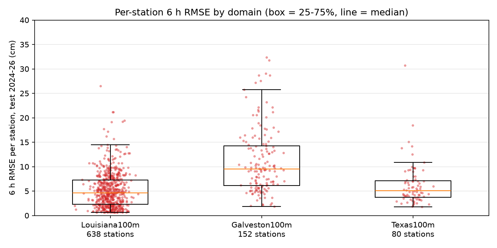

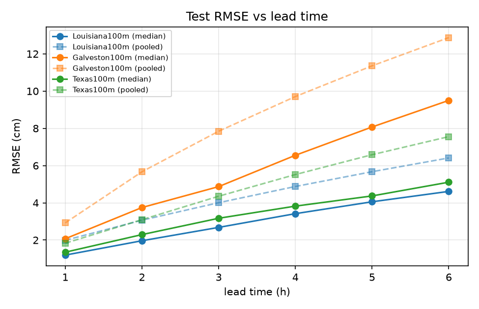

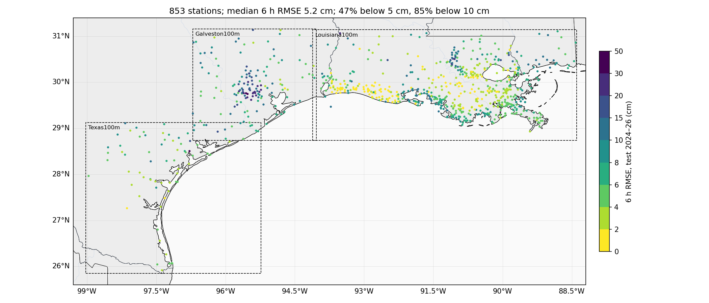

- **Louisiana100m（638 站）**：最好，中位 4.6 cm，92% 的站 6 小时误差在 10 cm 以内。CRMS 湿地站密集、水位变化慢、潮差小。
- **Texas100m（80 站）**：中位 5.1 cm，91% 在 10 cm 以内。以 NOAA 潮位站和 USGS 河口站为主，Texas 潮差本身小。
- **Galveston100m（152 站）**：最差，中位 9.5 cm，只有 56% 在 10 cm 以内。141 个 USGS 站里一大半是休斯顿城市溪流（Buffalo/Brays/Whiteoak/Greens Bayou，地图上休斯顿那一团深色点），暴雨后几小时涨几米，这类站把中位数拉高。该域 11 个 NOAA 潮位站 6.6 cm，和路易斯安那的一样。
- 误差随提前量近似线性增长：三个域 1 小时 1.2–2.1 cm，6 小时 4.6–9.5 cm。

## 三个 domain 整体（测试集 2024-01 至 2026-11，所有站，单位 cm）

| domain | 站数 | 1 h | 2 h | 3 h | 4 h | 5 h | **6 h** | 6 h 四分位 (25%–75%) | 6 h < 5 cm 的站 | 6 h < 10 cm 的站 | 6 h pooled |
|---|---|---|---|---|---|---|---|---|---|---|---|
| Louisiana100m | 638 | 1.2 | 2.0 | 2.7 | 3.4 | 4.1 | **4.6** | 2.3–7.3 | 55% | 92% | 6.4 |
| Galveston100m | 152 | 2.1 | 3.7 | 4.9 | 6.6 | 8.1 | **9.5** | 6.1–14.3 | 14% | 56% | 12.9 |
| Texas100m | 80 | 1.3 | 2.3 | 3.2 | 3.8 | 4.4 | **5.1** | 3.7–7.1 | 49% | 91% | 7.6 |
| ALL | 853 | 1.3 | 2.2 | 3.0 | 3.8 | 4.4 | **5.2** | 2.9–8.2 | 47% | 85% | 8.2 |

每格是该 domain 内各站 RMSE 的中位数；pooled 是把所有站的误差堆在一起算的 RMSE（受误差大的站影响大）。

## domain × 数据源（6 h RMSE 中位数，cm）

| domain | 来源 | 站数 | 1 h | 3 h | **6 h** | 6 h 四分位 |
|---|---|---|---|---|---|---|
| Galveston100m | NOAA_COOPS | 11 | 2.6 | 4.7 | **6.6** | 6.2–8.4 |
| Galveston100m | USGS | 141 | 1.9 | 5.0 | **9.8** | 5.8–14.7 |
| Louisiana100m | CRMS | 405 | 1.1 | 2.3 | **3.9** | 1.9–6.5 |
| Louisiana100m | NOAA_COOPS | 21 | 2.1 | 3.9 | **6.6** | 4.4–9.1 |
| Louisiana100m | USGS | 212 | 1.2 | 3.1 | **5.4** | 3.6–8.6 |
| Texas100m | NOAA_COOPS | 24 | 1.8 | 2.8 | **4.0** | 3.1–4.5 |
| Texas100m | USGS | 56 | 1.2 | 3.5 | **6.2** | 4.2–9.1 |

## 代表性站点（测试集全段 RMSE，cm）

| 站 | 说明 | 1 h | 2 h | 3 h | 4 h | 5 h | **6 h** |
|---|---|---|---|---|---|---|---|
| NOAA_COOPS 8761724 | Grand Isle (open coast, LA) | 1.8 | 2.6 | 2.8 | 3.2 | 3.6 | **4.2** |
| NOAA_COOPS 8761927 | New Canal, Lake Pontchartrain (LA) | 2.5 | 2.6 | 3.0 | 3.5 | 3.9 | **4.4** |
| USGS 07381600 | Lower Atchafalaya at Morgan City (river+tide, LA) | 1.2 | 2.3 | 3.3 | 4.2 | 4.9 | **5.4** |
| CRMS CRMS0311-H01 | CRMS0311 Barataria marsh (LA) | 2.3 | 3.8 | 4.7 | 5.4 | 6.1 | **6.5** |
| NOAA_COOPS 8771450 | Galveston Pier 21 (TX) | 2.5 | 3.8 | 4.7 | 5.4 | 6.0 | **6.6** |
| NOAA_COOPS 8770613 | Morgans Point, upper Galveston Bay (TX) | 2.6 | 3.4 | 4.1 | 5.1 | 6.1 | **6.9** |
| USGS 08074000 | Buffalo Bayou at Houston (urban bayou, TX) | 4.8 | 9.7 | 15.3 | 19.9 | 24.7 | **28.7** |
| NOAA_COOPS 8774770 | Rockport (TX) | 1.0 | 1.4 | 1.7 | 1.9 | 2.2 | **2.4** |
| NOAA_COOPS 8779770 | Port Isabel (TX) | 1.9 | 2.3 | 2.8 | 3.3 | 3.8 | **4.2** |
| USGS 08211500 | Nueces River at Calallen (tidal river, TX) | 0.6 | 1.1 | 1.6 | 2.1 | 2.5 | **2.9** |
| USGS 08188500 | San Antonio River at Goliad (inland river, TX) | 2.5 | 3.7 | 4.9 | 6.1 | 7.9 | **9.7** |

## 代表性站点的图

每张图：左三格是三个时段（Francine 2024-09 路易斯安那登陆、Beryl 2024-07 德州登陆、2025-03 一个平静周）的观测（黑）和 6 小时前发出的 LSTM 预报（红）；右格是该站 1–6 小时各提前量在整个测试期的 RMSE。

**潮位站**：潮汐节律完全学到了，红线基本压在黑线上。风暴期间（Francine 9/11–12 的增水、Beryl 7/8 的增水）模型能跟上涨落，但峰值会偏高或偏低一二十厘米，且有几小时滞后——这部分是风推的水，正是后面加风场要补的。

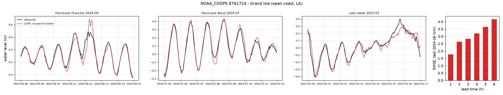
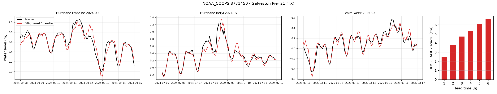
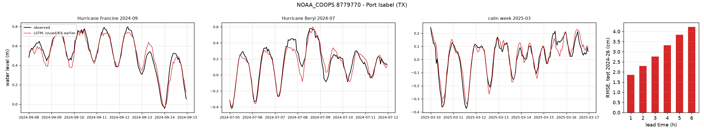
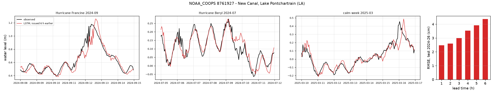
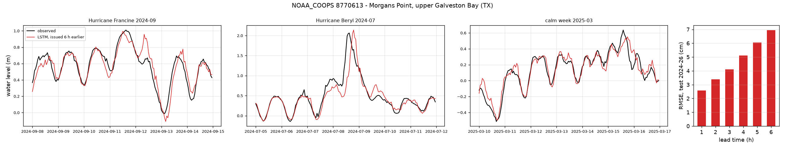
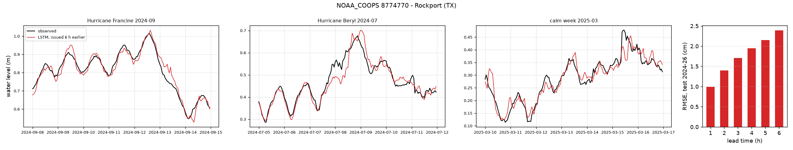

**河口 / 湿地站**：Morgan City 是潮汐叠加大河流量，6 小时 5.4 cm；CRMS 湿地站 6.5 cm。

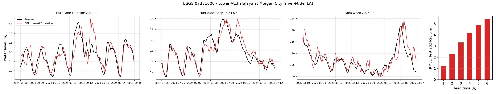
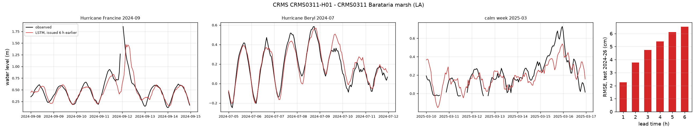

**内陆河流站**：San Antonio River at Goliad，平时水位变化只有几厘米，模型在小波动上会多猜一些（平静周红线比黑线抖），涨水时能跟上但过头。Nueces at Calallen 几乎不动，6 小时 2.9 cm。

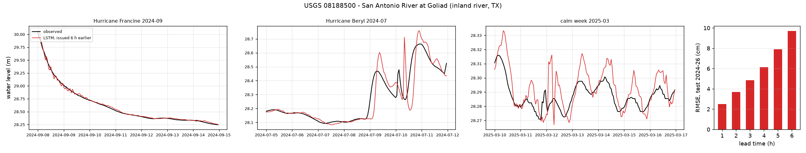
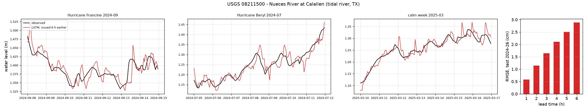

**城市溪流**：Buffalo Bayou at Houston，6 小时 28.7 cm，是代表站里最差的；1 小时还只有 4.8 cm，误差随提前量几乎直线上升，说明暴涨的时机和幅度靠过去的水位本身猜不出来。Beryl 期间 7 月 8 日涨 7 米，模型跟上了涨势但落后几小时。**注意**：这张图里观测在 8 米附近被截断了——是建数据集时"偏离平均 8 倍标准差就当野值删掉"的规则把真实洪峰删了（见下面问题 1）。

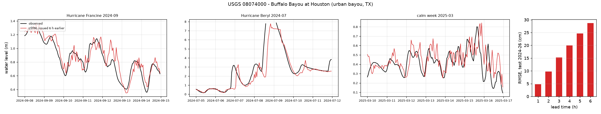

## 这一版已知的问题

1. **去野值规则误删真实洪峰**。8 倍标准差的规则对暴涨型溪流不合适（Buffalo Bayou 平时标准差 0.9 m，Beryl 涨到 8 m 被删）。影响的是德州城市溪流站的极端事件，对潮位站和湿地站没有影响。下一版改成只删孤立的单小时尖刺。
2. **训练还没完全收敛**。20 轮结束时验证误差还在缓慢下降（每轮约 0.1 mm），再训练长一些或模型大一些可能还有 1–3 mm 的提升。
3. **CRMS 的测试数据只到 2026 年 6–7 月**（周报滞后），且业务上拿不到实时值。

## 文件

- `02_per_station_test.csv`：853 站 × 1–6 小时的 RMSE（cm）和样本数
- `02_domain_summary.csv`、`02_domain_source_summary.csv`：上面两张表的原始数字（含 1–6 小时全部提前量）
- `02_station_forecasts.csv`：代表站三个时段的观测 / 预报序列
- 模型和训练记录：仓库 `runs/v1_gpu/`（QBD 作业 1169154）
