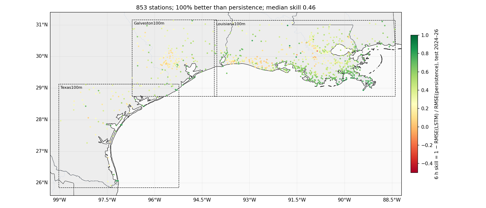

# 02 第一版可用模型（v1）结果：测试集 2024-01 至 2026-11，提前 6 小时

## 这一版是什么

- **数据**：1010 个站（CRMS 552、USGS 403、NOAA 54、USACE MVN 1），2010 年起的小时水位。对比 v0 的改动：去掉了填充值、23 个站做了基准面平移、USACE SWG 整个来源不用（原因见 `01_excluded_stations.md`）。
- **划分**：2010–2022 训练，2023 验证，2024–2026 测试。下面所有数字都来自测试集，模型训练时没见过。
- **模型**：一个全站共用的 LSTM（30 万参数），输入过去 72 小时的水位，输出未来 1–6 小时的水位。只用水位观测，不用任何气象或模式数据。QBD 的 A100 上训练 14 分钟。
- **对照**：persistence（"6 小时后 = 现在"）。所有 RMSE 单位厘米。
- **统计口径**：每个站算自己的 RMSE，然后看中位数——这是"一个典型的站做得怎么样"。pooled 是所有站误差堆在一起算，会被误差大的站拉高，仅作参考。
- 853 个站有至少一个月的测试期数据参与统计（其余 157 站主要是 2024 年后停测或 CRMS 周报还没覆盖到）。

## 一句话结论

典型站点 6 小时预报误差 **5.2 cm**（persistence 11.6 cm），**853 个站全部优于 persistence**；47% 的站 6 小时误差在 5 cm 以内，85% 在 10 cm 以内。潮位站最好（4–7 cm，误差只有 persistence 的三分之一），路易斯安那湿地站次之（3.9 cm），休斯顿的城市溪流最差（20–30 cm，暴涨暴落、只看水位猜不到）。

## 三个 domain

- **Louisiana100m（638 站）**：最好，中位 4.6 cm。CRMS 湿地站密集、水位变化慢、潮差小，模型和 persistence 都容易，但模型仍把误差砍掉一半以上。
- **Texas100m（80 站）**：中位 5.1 cm。以 NOAA 潮位站和 USGS 河口站为主；Texas 潮差小（Rockport 6 h persistence 只有 5.4 cm），所以绝对误差小。
- **Galveston100m（152 站）**：最差，中位 9.5 cm。141 个 USGS 站里一大半是休斯顿城市溪流（Buffalo/Brays/Whiteoak/Greens Bayou），暴雨后几小时涨几米，这类站把中位数拉高。NOAA 潮位站（11 个）6.6 cm，和路易斯安那的一样好。

## 三个 domain 整体（测试集 2024-01 至 2026-11，所有站）

| domain | 站数 | 6 h RMSE 中位数 LSTM | 6 h RMSE 中位数 persistence | 1 h 中位数 LSTM / pers. | 3 h 中位数 LSTM / pers. | 优于 persistence 的站 | 6 h pooled LSTM / pers. |
|---|---|---|---|---|---|---|---|
| Galveston100m | 152 | **9.5 cm** | 16.2 cm | 2.1 / 4.1 cm | 4.9 / 9.9 cm | 100% | 12.9 / 18.9 cm |
| Louisiana100m | 638 | **4.6 cm** | 10.6 cm | 1.2 / 2.6 cm | 2.7 / 6.3 cm | 100% | 6.4 / 14.9 cm |
| Texas100m | 80 | **5.1 cm** | 10.2 cm | 1.3 / 2.4 cm | 3.2 / 6.3 cm | 100% | 7.6 / 14.0 cm |
| ALL | 853 | **5.2 cm** | 11.6 cm | 1.3 / 2.8 cm | 3.0 / 7.0 cm | 100% | 8.2 / 15.6 cm |

## domain × 数据源（6 h，中位数）

| domain | 来源 | 站数 | LSTM | persistence | 中位 skill | 优于 persistence |
|---|---|---|---|---|---|---|
| Galveston100m | NOAA_COOPS | 11 | 6.6 cm | 22.9 cm | 0.70 | 100% |
| Galveston100m | USGS | 141 | 9.8 cm | 15.2 cm | 0.28 | 100% |
| Louisiana100m | CRMS | 405 | 3.9 cm | 8.4 cm | 0.54 | 100% |
| Louisiana100m | NOAA_COOPS | 21 | 6.6 cm | 22.3 cm | 0.68 | 100% |
| Louisiana100m | USGS | 212 | 5.4 cm | 10.8 cm | 0.44 | 99% |
| Texas100m | NOAA_COOPS | 24 | 4.0 cm | 11.6 cm | 0.66 | 100% |
| Texas100m | USGS | 56 | 6.2 cm | 10.1 cm | 0.31 | 100% |

## 代表性站点（6 h RMSE，测试集全段）

| 站 | 说明 | LSTM 1 h | LSTM 3 h | LSTM 6 h | persistence 6 h | skill 6 h |
|---|---|---|---|---|---|---|
| NOAA_COOPS 8761724 | Grand Isle (open coast, LA) | 1.8 cm | 2.8 cm | **4.2 cm** | 20.3 cm | 0.80 |
| NOAA_COOPS 8761927 | New Canal, Lake Pontchartrain (LA) | 2.5 cm | 3.0 cm | **4.4 cm** | 7.7 cm | 0.43 |
| USGS 07381600 | Lower Atchafalaya at Morgan City (river+tide, LA) | 1.2 cm | 3.3 cm | **5.4 cm** | 13.2 cm | 0.59 |
| CRMS CRMS0311-H01 | CRMS0311 Barataria marsh (LA) | 2.3 cm | 4.7 cm | **6.5 cm** | 20.6 cm | 0.68 |
| NOAA_COOPS 8771450 | Galveston Pier 21 (TX) | 2.5 cm | 4.7 cm | **6.6 cm** | 25.0 cm | 0.73 |
| NOAA_COOPS 8770613 | Morgans Point, upper Galveston Bay (TX) | 2.6 cm | 4.1 cm | **6.9 cm** | 22.9 cm | 0.70 |
| USGS 08074000 | Buffalo Bayou at Houston (urban bayou, TX) | 4.8 cm | 15.3 cm | **28.7 cm** | 38.1 cm | 0.25 |
| NOAA_COOPS 8774770 | Rockport (TX) | 1.0 cm | 1.7 cm | **2.4 cm** | 5.4 cm | 0.56 |
| NOAA_COOPS 8779770 | Port Isabel (TX) | 1.9 cm | 2.8 cm | **4.2 cm** | 23.0 cm | 0.82 |
| USGS 08211500 | Nueces River at Calallen (tidal river, TX) | 0.6 cm | 1.6 cm | **2.9 cm** | 3.3 cm | 0.14 |
| USGS 08188500 | San Antonio River at Goliad (inland river, TX) | 2.5 cm | 4.9 cm | **9.7 cm** | 17.4 cm | 0.44 |

## 代表性站点的图

每张图：左三格是三个时段（Francine 2024-09 路易斯安那登陆、Beryl 2024-07 德州登陆、2025-03 一个平静周）的观测（黑）、LSTM 提前 6 小时的预报（红）、persistence（蓝虚线）；右格是该站 1–6 小时各提前量的 RMSE。

**潮位站**：潮汐节律完全学到了，红线基本压在黑线上，蓝线错开一个相位。风暴期间（Francine 9/11–12 的增水）模型能跟上涨，但峰值会偏高或偏低几十厘米——这就是风场能补的部分。

**河口 / 湿地站**：Morgan City 是潮汐叠加大河流量，模型 5.4 cm；CRMS 湿地站 6.5 cm，比它的 persistence（20.6 cm）好很多。

**内陆河流站**：San Antonio River at Goliad，平时水位变化只有几厘米，模型在小波动上会多猜一些（平静周红线比黑线抖），涨水时能跟上但过头。Nueces at Calallen 几乎不动，persistence 本身只有 3.3 cm，模型只好一点点。

**城市溪流**：Buffalo Bayou at Houston，6 小时误差 28.7 cm，是代表站里最差的。Beryl 期间 7 月 8 日涨 7 米，模型跟上了涨势但落后几小时。**注意**：这张图里观测在 8 米附近被截断了——是建数据集时"偏离平均 8 倍标准差就当野值删掉"的规则把真实洪峰删了（见下面问题 1）。

## 这一版已知的问题

1. **去野值规则误删真实洪峰**。8 倍标准差的规则对暴涨型溪流不合适（Buffalo Bayou 平时标准差 0.9 m，Beryl 涨到 8 m 被删）。影响的是德州城市溪流站的极端事件，对潮位站和湿地站没有影响。下一版改成只删孤立的单小时尖刺。
2. **训练还没完全收敛**。20 轮结束时验证误差还在缓慢下降（每轮约 0.1 mm），再训练长一些或模型大一些可能还有 1–3 mm 的提升。
3. **潮位站还没和 NOAA 潮汐预报比**。persistence 对潮位站太弱，和潮汐预报比才公平，这是下一步。
4. **CRMS 的测试数据只到 2026 年 6–7 月**（周报滞后），且业务上拿不到实时值。

## 文件

- `02_per_station_test.csv`：853 站 × 1–6 小时的 RMSE（模型、persistence）和 skill
- `02_domain_summary.csv`、`02_domain_source_summary.csv`：上面两张表的原始数字
- `02_station_forecasts.csv`：代表站三个时段的观测 / 预报序列
- 模型和训练记录：仓库 `runs/v1_gpu/`（QBD 作业 1169154）
