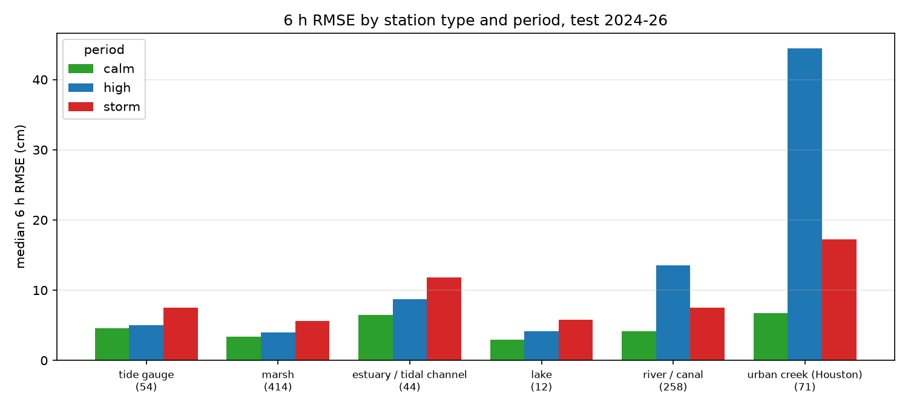

# 04 误差在哪里：按时段和站点类型拆分

目的：回答"只用水位的模型，误差主要出在什么时候、什么样的站"，作为加风场和流量的依据。模型是 02 里的 v2（40 轮），测试集 2024–2026，提前 6 小时。

## 误差按时段拆分（测试集，提前 6 小时，RMSE cm）

时段定义：**storm** = 本域 NOAA 潮位站非潮汐偏差（观测 − 潮汐预报）日均绝对值排前 10% 的日子（冷锋、风暴）；**high** = 该站自身水位高于其测试期 95% 分位（河流涨水、持续壅水），且不是 storm 日；**calm** = 其余时间。

| 站点类型 | 站数 | calm | high | storm | 全部 | 样本占比 calm/high/storm | 误差（平方和）占比 calm/high/storm |
|---|---|---|---|---|---|---|---|
| tide gauge | 54 | 4.6 | 5.0 | 7.5 | 4.9 | 86/4/10% | 68/6/26% |
| marsh | 414 | 3.4 | 4.0 | 5.6 | 3.8 | 86/4/11% | 69/5/26% |
| estuary / tidal channel | 44 | 6.4 | 8.7 | 11.8 | 7.1 | 86/4/10% | 41/38/21% |
| lake | 12 | 3.0 | 4.1 | 5.8 | 3.4 | 86/4/10% | 65/5/30% |
| river / canal | 258 | 4.1 | 13.6 | 7.5 | 6.2 | 86/4/10% | 40/44/17% |
| urban creek (Houston) | 71 | 6.7 | 44.4 | 17.2 | 13.2 | 86/4/10% | 27/55/18% |
| **全部** | 853 | 4.2 | 6.0 | 7.3 | 5.2 | 86/4/10% | 41/39/19% |

RMSE 列是该类站各站 RMSE 的中位数。最后两列说明：各时段占了多少预报样本，以及占了多少误差（平方和）——误差占比远大于样本占比的时段，就是模型最吃力、需要外部输入的时段。

## 按 domain

| domain | 站数 | calm | high | storm | 全部 | 样本占比 | 误差占比 |
|---|---|---|---|---|---|---|---|
| Louisiana100m | 638 | 4.0 | 4.8 | 6.5 | 4.5 | 86/4/10% | 57/21/22% |
| Galveston100m | 152 | 5.9 | 28.7 | 13.4 | 9.8 | 86/4/10% | 29/53/18% |
| Texas100m | 80 | 3.5 | 11.7 | 6.2 | 6.0 | 86/4/10% | 43/46/12% |

## 怎么读

- **潮位站、湿地站、湖泊**：误差集中在 **storm 日**——10% 的日子贡献了 26–30% 的误差，风暴日 RMSE 是平静日的 1.6–1.9 倍。这些站平时的潮汐和缓慢变化模型已经学得很好，剩下的就是风推的增减水。→ **风场**能补。
- **河流、河口、城市溪流**：误差集中在 **自身高水位期**——只占 4% 的样本，却贡献了 38–55% 的误差；城市溪流涨水期 RMSE 44 cm，是平静期的 6.6 倍。涨水是上游来水造成的，只看本站过去的水位猜不到何时涨、涨多高。→ **流量**能补。
- 按 domain 看：Louisiana 误差有五分之一在 storm 日（潮位站和湿地为主）；Galveston 一半以上的误差在高水位期（城市溪流）；Texas 介于两者之间。
- 平静期（86% 的时间）全部站的中位 RMSE 只有 4.2 cm，这部分已经够用，加输入的收益不在这里。

## 文件

- `04_error_split.csv`：每站在三个时段的 6 h RMSE 和样本数、站点类型
- 站点类型规则：NOAA → 潮位站；CRMS 和 USGS 湿地站 → 湿地；USGS 按站类代码分为河口/感潮河道、湖泊、河流/运河；Galveston 域内休斯顿周边各县的 USGS 河流站 → 城市溪流
