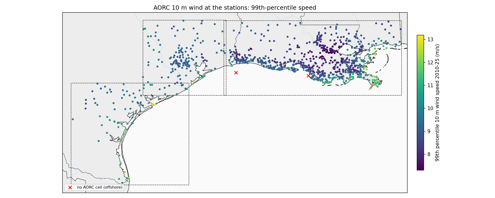
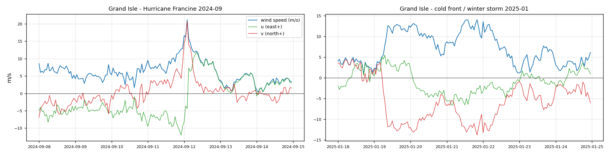
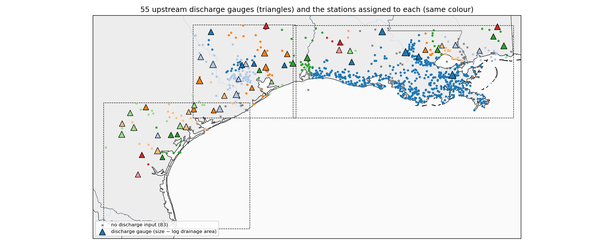
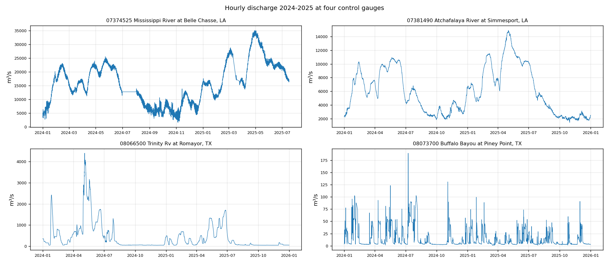

# 05 风场和流量输入的基本情况

## 一、风场

| 项目 | 内容 |
|---|---|
| 数据 | NOAA AORC v1.1（Analysis of Record for Calibration），NOAA 为水文模型校准做的再分析驱动场 |
| 变量 | 10 m 高度风 u、v 分量（m/s） |
| 分辨率 | 1 km，逐小时，UTC |
| 时段 | 用了 2010-01-01 至 2025-12-31；AORC 本身 1979 年起，到 2025 年底 |
| 获取 | AWS 公开桶 `s3://noaa-nws-aorc-v1-1-1km`，不用账号；按每个站的经纬度取最近的格点，全部 16 年 13 分钟提完 |
| 格点到站点距离 | 中位 0.34 km，最大 0.60 km（1 km 格点，基本就是站点所在格） |
| 覆盖 | 每年有效率 99.5%–99.8%；2 个站落在海上无格点：NOAA_COOPS 8764314 Eugene Island, North of, Atchafalaya Bay、NOAA_COOPS 8771367 Sabine Offshore Light |
| 风速统计（全部站 2010–2025） | 中位 3.1 m/s，平均 3.4 m/s，99% 分位 9.3 m/s，最大 36.4 m/s |
| 进模型的方式 | 过去 72 小时每小时的 u、v（除以 10 做尺度归一）+ 有无数据标记；可选再给未来 6 小时的 u、v（训练用 AORC 代替预报，业务上换成 RRFS/NAM 预报风） |
| 2026 年 | AORC 没有 2026，所以加风的实验统一在 2024–2025 上评估 |

按 domain 的风速（各站 2010–2025，m/s）：

| domain | 站数 | 平均风速（站中位） | 99% 分位（站中位） | 最大（所有站） |
|---|---|---|---|---|
| Louisiana100m | 793 | 3.3 | 8.7 | 36.4 |
| Galveston100m | 152 | 3.4 | 9.3 | 30.6 |
| Texas100m | 80 | 4.0 | 9.9 | 30.6 |

## 二、流量

| 项目 | 内容 |
|---|---|
| 数据 | USGS NWIS 瞬时流量（要素 00060），15 分钟原始值平均到小时，单位 m³/s；历史和实时是同一个接口 |
| 时段 | 2010-01-01 至今（实时） |
| 选站规则 | 三个 domain 范围内 277 个有实时流量的 USGS 站里，每个 HUC8 流域取汇水面积最大、2012 年前就有记录的一个 → **58 个上游控制站**，55 个有数据（3 个接口不返回：301141089320300、07385500、0248018020） |
| 汇水面积 | 最大密西西比 Belle Chasse 2.93 百万 km²，最小 57 km²；中位 2142 km² |
| 数据完整度 | 55 个站 2010–2026 小时有效率中位 99%，最低 4% |
| 配给水位站 | 每个水位站配一个上游站：USGS 站用自己的 HUC8（498 站）；CRMS/NOAA 站按经纬度查 HUC8；Barataria、Terrebonne、下 Atchafalaya、Breton Sound、Maurepas、Mermentau 这些没有上游站的海岸流域手动指给喂它们的河（468 站）。最终 **927/1010 站有流量输入**，83 站没有（流域内没有控制站，或控制站接口无数据） |
| 进模型的方式 | 过去 72 小时每小时的流量，取 log(1+Q) 后按各控制站 2010–2022 的均值/标准差标准化 + 有无数据标记；没有流量的站输入为 0、标记为 0 |

控制站一览（按汇水面积，流量 m³/s，2010–2026）：

| 站 | 河流 / 站名 | 汇水面积 km² | 配给的水位站数 | 有效率 | 中位流量 | 90% 分位 | 最大 | 最大出现 |
|---|---|---|---|---|---|---|---|---|
| 07374525 | Mississippi River at Belle Chasse, LA | 2,926,689 | 225 | 94% | 14,564 | 27,800 | 38,582 | 2016-01-22 |
| 07374000 | Mississippi River at Baton Rouge, LA | 2,915,837 | 1 | 100% | 14,548 | 28,119 | 40,564 | 2011-05-19 |
| 07381490 | Atchafalaya River at Simmesport, LA | 226,805 | 214 | 87% | 6,124 | 12,382 | 19,723 | 2011-05-24 |
| 08116650 | Brazos Rv nr Rosharon, TX | 117,428 | 8 | 91% | 73 | 744 | 3,766 | 2017-08-29 |
| 08111500 | Brazos Rv nr Hempstead, TX | 113,649 | 7 | 99% | 48 | 611 | 4,325 | 2016-05-27 |
| 08162500 | Colorado Rv nr Bay City, TX | 109,401 | 2 | 18% | 105 | 498 | 2,476 | 2017-09-02 |
| 08161000 | Colorado Rv at Columbus, TX | 107,847 | 2 | 99% | 20 | 77 | 4,573 | 2017-08-29 |
| 08067000 | Trinity Rv at Liberty, TX | 45,242 | 6 | 62% | 181 | 1,139 | 3,922 | 2024-05-06 |
| 08066500 | Trinity Rv at Romayor, TX | 44,512 | 11 | 100% | 65 | 819 | 4,396 | 2024-05-04 |
| 08211500 | Nueces Rv at Calallen, TX | 43,211 | 7 | 100% | 0 | 4 | 274 | 2015-05-24 |
| 08188800 | Guadalupe Rv nr Tivoli, TX | 26,231 | 9 | 96% | 26 | 77 | 111 | 2023-05-18 |
| 08041780 | Neches Rv Saltwater Barrier at Beaumont, TX | 25,353 | 7 | 99% | 124 | 616 | 6,555 | 2017-09-02 |
| 08030500 | Sabine Rv nr Ruliff, TX | 24,162 | 22 | 100% | 103 | 508 | 5,819 | 2016-03-16 |
| 301141089320300 | EAST PEARL RIVER AT CSX RAILROAD NR CLAIBORNE, MS | 22,466 | 17 | — | 接口无数据 | | | |
| 02479310 | PASCAGOULA RIVER AT GRAHAM FERRY, MS | 21,248 | 3 | 94% | 220 | 1,085 | 3,830 | 2016-03-18 |
| 08194500 | Nueces Rv nr Tilden, TX | 20,961 | 2 | 100% | 0 | 7 | 803 | 2013-10-18 |
| 08206910 | Choke Canyon Res OWC nr Three Rivers, TX | 14,219 | 2 | 95% | 1 | 1 | 34 | 2025-06-14 |
| 08188570 | San Antonio Rv nr McFaddin, TX | 10,707 | 7 | 99% | 9 | 33 | 343 | 2021-07-15 |
| 02475000 | LEAF RIVER NR MCLAIN, MS | 9,052 | 1 | 94% | 78 | 442 | 2,557 | 2016-03-15 |
| 08033000 | Neches Rv nr Diboll, TX | 7,055 | 2 | 74% | 24 | 166 | 711 | 2024-05-15 |
| 08015500 | Calcasieu River near Kinder, LA | 4,403 | 4 | 48% | 15 | 108 | 1,203 | 2016-03-15 |
| 07380120 | Amite River at Port Vincent, LA | 4,134 | 73 | 99% | 37 | 179 | 5,635 | 2016-08-15 |
| 07385500 | BAYOU TECHE @ ARNAUDVILLE, LA | 3,963 | 20 | — | 接口无数据 | | | |
| 08012150 | Mermentau River At Mermentau, LA | 3,577 | 132 | 85% | 32 | 180 | 1,102 | 2013-01-15 |
| 08110800 | Navasota Rv at Old San Antonio Rd nr Bryan, TX | 3,333 | 4 | 100% | 2 | 30 | 1,900 | 2024-05-04 |
| 02492000 | Bogue Chitto River near Bush, LA | 3,142 | 3 | 99% | 33 | 101 | 2,362 | 2016-03-13 |
| 08110000 | Yegua Ck nr Somerville, TX | 2,613 | 2 | 100% | 0 | 30 | 212 | 2016-05-29 |
| 0248018020 | ESCATAWPA RIVER AT I-10 NR ORANGE GROVE, MS | 2,517 | 2 | — | 接口无数据 | | | |
| 08068090 | W Fk San Jacinto Rv abv Lk Houston nr Porter, TX | 2,492 | 7 | 97% | 3 | 36 | 3,710 | 2017-08-29 |
| 08041500 | Village Ck nr Kountze, TX | 2,227 | 2 | 99% | 8 | 54 | 5,140 | 2017-08-31 |
| 08186000 | Cibolo Ck nr Falls City, TX | 2,142 | 1 | 100% | 1 | 3 | 442 | 2016-08-21 |
| 08164000 | Lavaca Rv nr Edna, TX | 2,116 | 1 | 100% | 1 | 5 | 2,097 | 2017-08-29 |
| 08206700 | San Miguel Ck nr Tilden, TX | 2,028 | 1 | 100% | 0 | 0 | 158 | 2010-04-16 |
| 08117500 | San Bernard Rv nr Boling, TX | 1,883 | 3 | 100% | 1 | 29 | 1,534 | 2017-09-01 |
| 02479160 | BLACK CREEK NR WIGGINS, MS | 1,816 | 4 | 26% | 17 | 64 | 708 | 2019-05-13 |
| 08189500 | Mission Rv at Refugio, TX | 1,787 | 2 | 99% | 0 | 1 | 548 | 2021-07-11 |
| 07375500 | Tangipahoa River at Robert, LA | 1,673 | 10 | 100% | 18 | 59 | 3,398 | 2016-08-14 |
| 08164390 | Navidad Rv at Strane Pk nr Edna, TX | 1,500 | 5 | 98% | 0 | 4 | 734 | 2017-08-29 |
| 08207500 | Atascosa Rv nr McCoy, TX | 1,373 | 1 | 99% | 0 | 0 | 179 | 2015-05-16 |
| 08012000 | Bayou Nezpique near Basile, LA | 1,365 | 2 | 100% | 5 | 59 | 501 | 2017-05-05 |
| 08014500 | Ouiska Chitto Creek Near Oberlin, LA | 1,321 | 3 | 99% | 9 | 41 | 799 | 2018-03-31 |
| 08211900 | San Fernando Ck at Alice, TX | 1,313 | 2 | 100% | 0 | 0 | 355 | 2010-07-02 |
| 08212400 | Los Olmos Ck nr Falfurrias, TX | 1,243 | 1 | 98% | 0 | 0 | 55 | 2018-06-20 |
| 08068500 | Spring Ck nr Spring, TX | 1,059 | 14 | 100% | 2 | 21 | 2,217 | 2017-08-29 |
| 08070200 | E Fk San Jacinto Rv nr New Caney, TX | 1,005 | 4 | 100% | 2 | 13 | 3,398 | 2017-08-29 |
| 08041700 | Pine Island Bayou nr Sour Lake, TX | 870 | 1 | 100% | 1 | 29 | 1,430 | 2017-08-30 |
| 02481510 | WOLF RIVER NR LANDON, MS | 798 | 14 | 99% | 7 | 37 | 947 | 2012-09-01 |
| 08073700 | Buffalo Bayou at Piney Point, TX | 774 | 41 | 100% | 5 | 47 | 423 | 2017-08-31 |
| 08189700 | Aransas Rv nr Skidmore, TX | 640 | 1 | 100% | 0 | 0 | 267 | 2015-05-16 |
| 07376000 | Tickfaw River at Holden, LA | 640 | 7 | 99% | 5 | 23 | 1,010 | 2016-08-13 |
| 08162600 | Tres Palacios Rv nr Midfield, TX | 376 | 2 | 100% | 1 | 4 | 357 | 2019-06-06 |
| 08077600 | Clear Ck nr Friendswood, TX | 316 | 7 | 4% | 54 | 121 | 1,246 | 2017-08-29 |
| 07375000 | Tchefuncte River near Folsom, LA | 267 | 15 | 89% | 2 | 7 | 1,214 | 2016-03-12 |
| 08164600 | Garcitas Ck nr Inez, TX | 238 | 4 | 98% | 0 | 0 | 189 | 2017-08-27 |
| 08211520 | Oso Ck at Corpus Christi, TX | 234 | 4 | 99% | 0 | 0 | 131 | 2015-05-13 |
| 08189200 | Copano Ck nr Refugio, TX | 227 | 5 | 98% | 0 | 1 | 67 | 2017-08-29 |
| 08067500 | Cedar Bayou nr Crosby, TX | 168 | 2 | 99% | 0 | 2 | 300 | 2017-08-28 |
| 08042558 | W Fk Double Bayou at Eagle Ferry Rd nr Anahuac, TX | 57 | 5 | 89% | 1 | 6 | 170 | 2017-08-30 |

6 个控制站数据不完整（Colorado nr Bay City 18%、Clear Ck nr Friendswood 4%、Black Creek 到 2024-01 止、Calcasieu nr Kinder 48%、Trinity at Liberty 62%、Neches nr Diboll 74%）：缺的时段模型只看到"无数据"标记，不会用到错的值；配给它们的水位站一共 25 个，影响有限。

## 文件

- `05_wind_per_station.csv`：每站风场覆盖率、格点距离、平均/99%/最大风速
- `05_discharge_gauges.csv`：上表的原始数字
- `config/discharge_gauges.csv`、`config/station_discharge_map.csv`：控制站清单和站点配对（仓库里）