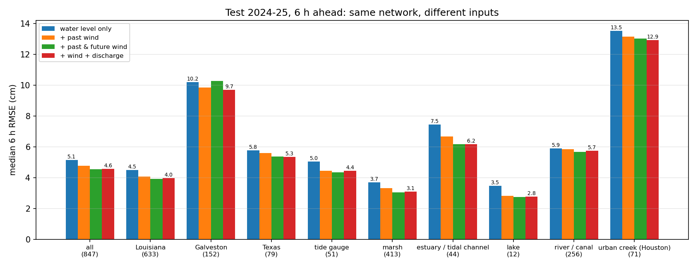
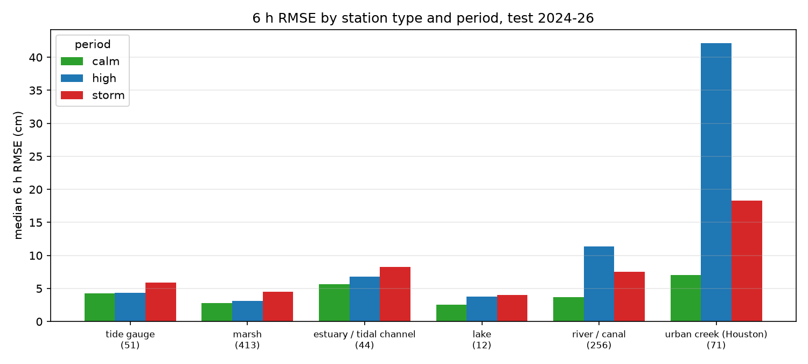

# 06 加风场和流量之后的结果（四组对比）

测试集 2024-01 → 2025-12（风场只到 2025 年底，四组都截到同一天），提前 6 小时，各站 RMSE 的中位数（cm）。四组用同一个网络、同一套划分、同样训练 40 轮，**只有输入不同**：

| 模型 | 输入 | 6 h RMSE 中位数 | 1 h | 3 h | 6 h < 5 cm 的站 | 6 h < 10 cm 的站 | 6 h pooled |
|---|---|---|---|---|---|---|---|
| 只用水位 | 过去 72 h 水位 | **5.15** | 1.24 | 3.00 | 48% | 85% | 8.3 |
| + 过去风 | + 过去 72 h 的 10 m 风 u、v | 4.78 | 1.24 | 2.86 | — | — | 7.9 |
| + 过去风 + 未来风 | + 未来 6 h 的风 | **4.53** | 1.26 | 2.80 | 55% | 88% | 7.7 |
| + 风 + 流量 | + 上游控制站过去 72 h 流量 | **4.56** | 1.23 | 2.78 | 55% | 88% | 7.7 |

只统计四组里都有足够样本的 847 个站（有风输入的模型要求窗口里有风数据，所以比只用水位少几个站）。完整表格：`06_compare_tables.md`；逐站数字：`06_compare_per_station.csv`。

## 一句话结论

- **风场明显有用**：6 h RMSE 中位数从 5.15 降到 4.53 cm（降 12%），85% 的站变好，373 个站好了 0.5 cm 以上、只有 15 个站差了 0.5 cm 以上。未来 6 小时的风比只给过去的风又多降 0.25 cm，说明业务上要接风场预报而不是只用分析场。
- **流量基本没用**：在风的基础上再加流量，中位数 4.53 → 4.56 cm（没变），只有 18 个站好了 0.5 cm 以上，集中在 Brazos 下游和 Houston 几条 bayou。河流站的"涨水期"误差 12.0 → 11.3 cm，城市溪流 44 → 42 cm，几乎没动。
- 建议下一个业务模型用 **+ 风 + 流量** 这一组（和 + 风 持平、Galveston 稍好、满足组里"加这两类输入"的要求），但要清楚流量这项目前没贡献，原因和改法见最后一节。

## 按 domain

| domain | 站数 | 只用水位 | + 过去风 | + 过去风 + 未来风 | + 风 + 流量 | < 5 cm 的站（只用水位 → +风+流量） | < 10 cm 的站 |
|---|---|---|---|---|---|---|---|
| Louisiana100m | 633 | 4.48 | 4.07 | 3.92 | 3.96 | 57% → 66% | 93% → 96% |
| Galveston100m | 152 | 10.20 | 9.84 | 10.26 | 9.69 | 12% → 13% | 49% → 52% |
| Texas100m | 79 | 5.77 | 5.61 | 5.36 | 5.33 | 43% → 44% | 89% → 91% |

Louisiana 和 Texas 都是风带来的改善；Galveston 的中位数由 Houston 城市溪流决定（152 个站里 71 个），这类站风和上游流量都帮不上，所以基本不动。

## 按站点类型

| 类型 | 站数 | 只用水位 | + 过去风 | + 过去风 + 未来风 | + 风 + 流量 | < 5 cm 的站 | < 10 cm 的站 |
|---|---|---|---|---|---|---|---|
| 潮位站 tide gauge | 51 | 5.05 | 4.43 | 4.34 | 4.44 | 49% → 59% | 98% → 100% |
| 湿地 marsh (CRMS) | 413 | 3.69 | 3.30 | 3.04 | 3.09 | 64% → 75% | 97% → 100% |
| 河口 / 潮汐通道 | 44 | 7.46 | 6.67 | 6.17 | 6.18 | 16% → 30% | 80% → 89% |
| 湖 | 12 | 3.47 | 2.82 | 2.73 | 2.76 | 75% → 75% | 100% → 100% |
| 河流 / 运河 | 256 | 5.90 | 5.85 | 5.66 | 5.75 | 39% → 40% | 79% → 80% |
| Houston 城市溪流 | 71 | 13.53 | 13.14 | 13.03 | 12.92 | 7% → 7% | 30% → 31% |

受潮汐和风影响的四类站（潮位站、湿地、河口、湖）都降了 0.7–1.3 cm；河流站只降 0.15 cm；城市溪流降 0.6 cm 但基数 13.5 cm。

## 风暴期 / 涨水期 / 平静期（和 04 同一口径）

| | 平静 calm | 涨水 high | 风暴 storm |
|---|---|---|---|
| 全部站，只用水位 → +风+流量 | 4.2 → 3.7 | 5.8 → 5.0 | 7.3 → 6.2 |
| 潮位站 | 4.8 → 4.2 | 5.3 → 4.4 | 7.7 → 5.9 |
| 湿地 | 3.4 → 2.8 | 3.9 → 3.2 | 5.6 → 4.5 |
| 河口 / 潮汐通道 | 6.6 → 5.7 | 9.0 → 6.8 | 11.6 → 8.3 |
| 河流 / 运河 | 3.9 → 3.7 | 12.0 → 11.3 | 7.9 → 7.5 |
| Houston 城市溪流 | 6.9 → 7.1 | 44.0 → 42.1 | 18.7 → 18.3 |
| Louisiana100m | 3.9 → 3.6 | 4.7 → 3.9 | 6.6 → 5.6 |
| Galveston100m | 6.1 → 5.9 | 27.4 → 26.9 | 14.8 → 14.8 |
| Texas100m | 3.2 → 3.1 | 12.8 → 11.3 | 6.4 → 5.6 |

误差平方和：风暴期降 25%，平静期降 15%，涨水期只降 7%。只看受潮汐影响的四类站，风暴期误差平方和降了 46%。这正好对上 04 的判断：风暴期的误差风能补，涨水期的误差要靠流量，而流量这次没补上。

## 几个站的逐月对比（蓝 = 只用水位，红 = +风+流量）

改善最大的几类：

- `06_station_8747437.png` Bay Waveland（Mississippi Sound 潮位站）：9.3 → 6.5 cm，每个月都变好，不只是风暴月——这片浅水的水位本来就被风顶着走。
- `06_station_301912088583300.png` Gulfport Light（Mississippi Sound）：9.8 → 6.6 cm。
- `06_station_CRMS0517-H01.png` CRMS0517（Teche/Vermilion 湿地）：12.7 → 9.7 cm。Teche/Vermilion 和 Terrebonne 的湿地站是 CRMS 里改善最大的一片。
- `06_station_08074000.png` Buffalo Bayou at Houston（城市 bayou）：29.4 → 27.5 cm，2024-07 Beryl 那个月 60 → 48 cm，其余月份几乎没变——暴雨涨水还是预报不到。

变差的站都是大河上的站，共 8 个差了 0.5 cm 以上：

- `06_station_08114000.png` Brazos River at Richmond：5.2 → 7.7 cm。变差几乎全在 2024-07：Hurricane Beryl 的强风输入让模型在这个离海 100 km 的河站上也报了一个 5 m 的假涨水尖峰（见图上 7 月那根红线）。Rosharon、Sugar Land 两个下游站同样。其余月份差 1 cm 左右。
- `06_station_07374000.png` Mississippi River at Baton Rouge：3.6 → 4.7 cm，每个月都差 1 cm 左右，没有单一事件——这类站风和流量都不提供新信息（流量控制站就是它自己所在河段），多出来的输入只是噪声。

## 流量为什么没起作用，下一步怎么改

1. **配站方式**：每个水位站配的是同一 HUC8 流域里"汇水面积最大"的那个控制站。配到大河（Mississippi、Atchafalaya、Brazos）的 352 个站都是海岸和湿地站，水位不由上游流量决定；而真正需要流量的 275 个河流 / 城市溪流站，配到的"同流域控制站"往往在旁边的支流上或者在它下游，和它的涨水没有因果关系。Houston 城市溪流的涨水是本地暴雨几个小时内冲出来的，上游没有任何站能提前看到。
2. **信息已经在水位里**：对大河下游站（Morgan City、Belle Chasse 一带），上游流量变化要走一两天才到，而过去 72 小时自己的水位已经包含了这个趋势，所以 6 小时预报用不上额外流量。
3. **可以试的改法**（任一条都只改 `config/station_discharge_map.csv` 或 `build_extras.py`，不动模型）：
   - 只给河流 / 城市溪流站配流量，且只配**同一条河上游**的站（按河流名和河段顺序手工配，不按 HUC8）；海岸和湿地站不配。
   - 把流量换成"上游站自己的水位"——USGS 上游站的水位比流量更新快、噪声小，而且不需要率定曲线。
   - 城市溪流的问题靠流量解决不了，要靠降雨（组里暂不加），所以这 71 个站的误差在当前输入下就是上限。

## 对业务化的影响

- 实时风已接上（2026-11-08）：训练用的是 AORC 再分析（1 km），业务用 NOAA HRRR（3 km、逐小时、AWS 公开）代替——过去 72 小时取逐时分析场，未来 6 小时取最新周期的 f01–f06，每站取最近格点。没用系统驱动 ROMS 的 NAM，因为它 3 小时一场、NOMADS 只留两天，拼不出 72 小时逐时。`scripts/operational/forecast.py` 现在按模型自动加风和流量输入，17Z 实跑 418 站 48 秒。
- 流量实时值和水位走同一个 USGS 接口（要素 00060），加上去没有额外成本。
- 两个离岸站（Eugene Island 8764314、Sabine Offshore Light 8771367）AORC 没有格点，没有风输入，仍用只用水位的模型或者取最近陆地格点。

## 文件

| 文件 | 内容 |
|---|---|
| `06_compare_tables.md` | 四组对比的全部表格（按 domain、类型、数据源、流量配站方式，改善 / 变差最大的站） |
| `06_compare_per_station.csv` | 847 个站四组的 1 / 3 / 6 h RMSE、变化量、类型、配的流量站 |
| `06_compare_bars.png` | 四组按 domain 和站点类型的 6 h RMSE 中位数 |
| `06_change_map.png` | 每个站 6 h RMSE 的变化（只用水位 → +风+流量）地图 |
| `06_domain_summary_wind_q.csv` | +风+流量 模型的 1–6 h 按 domain 汇总（02 的格式） |
| `06_error_split_wind_q.csv` / `.png` | +风+流量 模型的平静 / 涨水 / 风暴拆分（04 的格式） |
| `06_station_*.png` / `06_station_compare.csv` | 六个站两组模型的逐小时预报和逐月 RMSE |

训练记录：QBD 作业 1169754（只用水位）、1169751（+过去风）、1169752（+过去风+未来风）、1169753（+风+流量），每组 40 轮、每轮 40–50 秒；结果在 `runs/v3_*`。
