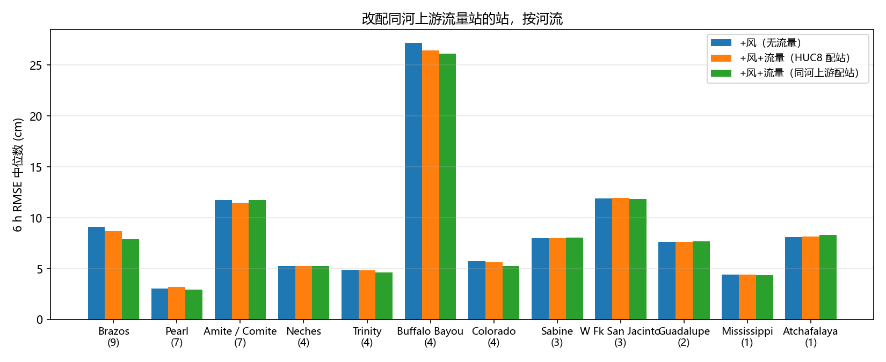
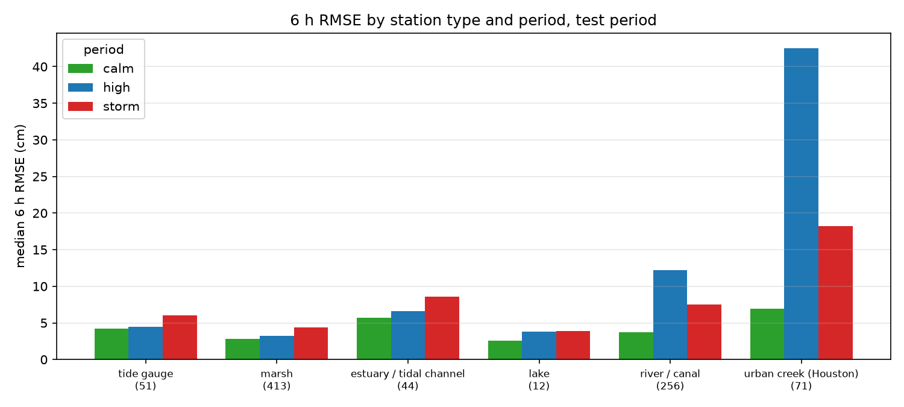
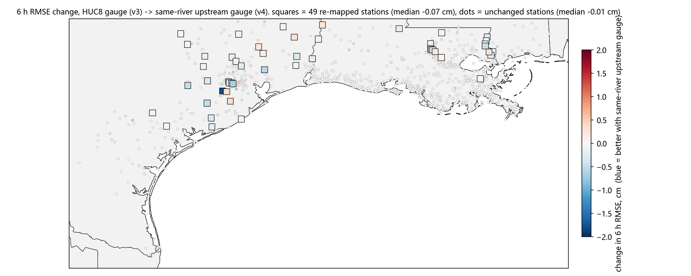

# 08 流量改配同一条河上游站之后的结果（v4 对 v3）

这一版改了什么：07 查出来，原来按 HUC8 流域给河流站配的"流量控制站"几乎都在该站的**下游**（Burkeville 配 Ruliff、Goodrich 配 Romayor、Town Bluff 配 Beaumont 盐水坝、Addicks 出口配 Piney Point），下游流量对上游站没有提前量。这次把 14 条河流链上的 49 个站改配成**同一条河紧挨着的上游站或大坝放水站**，新增 34 个控制站（共 92 个，87 个有数据）。其余 961 个站（海岸、湿地等）配法不变，网络、划分、40 轮训练、测试截止 2025-12-31T17 都和 v3_wind_q 相同，所以 v3 和 v4 的差别只来自这 49 个站的流量输入。QBD 作业 1170403，run `v4_wind_q`。

测试集 2024-01 → 2025-12，提前 6 小时，各站 RMSE 的中位数（cm），统计三组里都有足够样本的 847 个站：

| 模型 | 输入 | 全部站 6 h 中位数 | 1 h | 3 h | 6 h < 5 cm 的站 | 6 h < 10 cm 的站 | 6 h pooled |
|---|---|---|---|---|---|---|---|
| + 风（无流量） | 水位 + 过去和未来的风 | 4.53 | 1.26 | 2.80 | 56% | 87% | 7.7 |
| + 风 + 流量，HUC8 配站（v3） | + 同 HUC8 控制站的流量 | 4.56 | 1.23 | 2.78 | 55% | 88% | 7.7 |
| + 风 + 流量，同河上游配站（v4） | + 同河上游站 / 放水站的流量 | **4.54** | 1.23 | 2.78 | 56% | 87% | 7.7 |

只看改配的 49 个站：

| 模型 | 1 h | 3 h | 6 h | 6 h < 5 cm 的站 | 6 h < 10 cm 的站 | 6 h pooled |
|---|---|---|---|---|---|---|
| + 风（无流量） | 1.46 | 4.50 | 8.13 | 24% | 59% | 12.3 |
| HUC8 配站（v3） | 1.37 | 4.43 | 8.17 | 27% | 63% | 12.0 |
| 同河上游配站（v4） | **1.25** | **4.18** | **8.07** | 29% | 61% | **11.9** |

完整表格：`08_compare_tables.md`；逐站：`08_compare_per_station.csv`。

## 一句话结论

- **改配有效，但幅度小，只在改配的站上有**。改配的 49 个站 1 h 误差降 9%、3 h 降 6%、6 h 降 1%，误差平方和降 2%。49 个站里 6 h 变好 0.5 cm 以上的 4 个，变差 0.5 cm 以上的 0 个；和完全不加流量比，变好 12 个、变差 0 个。没改配的 798 个站 6 h 变化中位 0.05 cm、90% 分位 0.19 cm、最大 0.77 cm，这是两次训练之间的随机差异，上面的变化比它大。
- **改善出现在河流涨水期**：改配的站涨水期 6 h RMSE 8.9 → 7.6 cm（降 15%），平静期 5.9 → 5.7，风暴期 9.0 → 9.2 没变。这正是加流量想要的效果——上游来水提前告诉模型下游要涨。
- **见效的是大河中游站**：Brazos at Richmond 8.7 → 6.9 cm，Trinity at Liberty 4.4 → 3.9，Colorado at Columbus / Wharton 5.1 → 4.6 / 4.9 → 4.5，Buffalo Bayou W Belt / Piney Point 各降 0.6。
- **大坝正下游的站没有变好**：Sabine Burkeville 19.6 → 19.9、Trinity Goodrich 10.4 → 10.6、Neches Town Bluff 10.2 → 10.5。放水量由调度决定，上游来水预报不了它（见下）。
- **Amite / Comite 的小溪没有变好**（11.5 → 11.7）：上游站到它只有几小时，涨水同时发生，流量不比水位早。这批站只有降雨能补。
- 全部站的中位数几乎不动（4.56 → 4.54），因为改的只有 49 个站。**建议业务模型换成 v4_wind_q**：和 v3 持平或略好，配站在物理上说得通。

## 按 domain（全部站，v4）

| domain | 站数 | 1 h | 2 h | 3 h | 4 h | 5 h | **6 h** | 6 h 四分位 | 6 h < 5 cm 的站 | 6 h < 10 cm 的站 | 6 h pooled | v3 的 6 h |
|---|---|---|---|---|---|---|---|---|---|---|---|---|
| Louisiana100m | 633 | 1.1 | 1.8 | 2.5 | 3.0 | 3.5 | **3.9** | 2.1–5.8 | 66% | 95% | 5.4 | 3.96 |
| Galveston100m | 152 | 2.1 | 3.8 | 5.5 | 6.9 | 8.3 | **9.8** | 6.0–15.4 | 14% | 51% | 13.2 | 9.69 |
| Texas100m | 79 | 1.2 | 2.2 | 3.2 | 4.0 | 4.6 | **5.3** | 3.5–7.7 | 47% | 90% | 7.6 | 5.33 |
| 全部 | 847 | 1.2 | 2.1 | 2.8 | 3.4 | 3.9 | **4.5** | 2.6–7.1 | 56% | 87% | 7.7 | 4.56 |

三个 domain 的数字和 v3 相差都在 0.1 cm 以内，因为改配的站只有 49 个，其中 Galveston 域 28 个、Louisiana 域 20 个、Texas 域 5 个（有的站同时属于两个域）。

## 按站点类型（全部站，6 h RMSE 中位数，cm）

| 类型 | 站数 | + 风 | HUC8 配站（v3） | 同河上游（v4） | 6 h < 5 cm 的站 (v3 → v4) | < 10 cm 的站 |
|---|---|---|---|---|---|---|
| 潮位站 tide gauge | 51 | 4.34 | 4.44 | 4.38 | 59% → 59% | 100% → 100% |
| 湿地 marsh (CRMS) | 413 | 3.04 | 3.09 | 3.03 | 75% → 76% | 100% → 100% |
| 河口 / 潮汐通道 | 44 | 6.17 | 6.18 | 6.28 | 30% → 30% | 89% → 89% |
| 湖 | 12 | 2.73 | 2.76 | 2.73 | 75% → 75% | 100% → 100% |
| 河流 / 运河 | 256 | 5.66 | 5.75 | 5.81 | 40% → 40% | 80% → 79% |
| Houston 城市溪流 | 71 | 13.03 | 12.92 | 12.91 | 7% → 7% | 31% → 31% |

河流类中位数 5.75 → 5.81 看起来略升，但河流类 256 个站里只有 34 个改配了，中位数被另外 222 个站的随机抖动决定；改配的那 34 个站中位数 7.11 → 7.04，是变好的（见按河流表）。改配的 49 站里另外 12 个是 Houston 城市溪流（Buffalo Bayou、Brazos 下游）、3 个是河口站。

## 改配的站按河流（6 h RMSE 中位数，cm）

| 河流 | 站数 | + 风 | HUC8 配站（v3） | 同河上游（v4） | 涨水期 (v3 → v4) | 新配的上游 |
|---|---|---|---|---|---|---|
| Brazos | 9 | 9.09 | 8.68 | **7.92** | 7.6 → 6.4 | 逐站上游，链头 Highbank |
| Colorado | 4 | 5.74 | 5.61 | **5.26** | 17.3 → 14.5 | 逐站上游，链头 La Grange |
| Trinity | 4 | 4.91 | 4.85 | **4.62** | 6.2 → 5.5 | 逐站上游，链头 Crockett（Livingston 湖上游） |
| Buffalo Bayou | 4 | 27.17 | 26.43 | **26.14** | 57.5 → 57.0 | 逐站上游；两个闸门出口站无训练期流量，暂无输入 |
| Pearl | 7 | 3.05 | 3.21 | 2.96 | 1.7 → 1.4 | Bogalusa 配 Columbia MS，其余配 Bogalusa |
| W Fk San Jacinto | 3 | 11.92 | 11.93 | 11.85 | — | 逐站上游，链头 Huntsville（Conroe 湖上游） |
| Mississippi（Belle Chasse） | 1 | 4.44 | 4.40 | 4.36 | — | Baton Rouge |
| Neches | 4 | 5.26 | 5.28 | 5.28 | 4.3 → 3.8 | 逐站上游，链头 Diboll（Sam Rayburn 湖上游） |
| Sabine | 3 | 8.03 | 8.00 | 8.07 | 5.3 → 2.9 | Burkeville 配 Toledo Bend 坝出流 |
| Guadalupe | 2 | 7.65 | 7.63 | 7.69 | — | Cuero 配 Gonzales |
| Amite / Comite | 7 | 11.73 | 11.50 | 11.72 | 42.6 → 42.2 | 逐站上游，链头 Magnolia / Olive Branch |
| Atchafalaya（Simmesport） | 1 | 8.13 | 8.17 | 8.34 | — | Old River 出流渠 |

涨水期 = 该站自身水位高于其 95% 分位且不是风暴日（和 04 同一口径）。Sabine、Neches 涨水期降了，但它们全年的误差由夏季调峰放水决定（见下），所以全年中位数没动。

## 风暴期 / 涨水期 / 平静期（改配的 49 站，v3 → v4）

| | 平静 calm | 涨水 high | 风暴 storm |
|---|---|---|---|
| 6 h RMSE 中位数 | 5.9 → 5.7 | **8.9 → 7.6** | 9.0 → 9.2 |
| 误差平方和变化 | −2% | −3% | −1% |

涨水期中位数降 15%，但平方和只降 3%，因为平方和由 Buffalo Bayou 四个站的暴雨涨水（涨水期 RMSE 57 cm）决定，那部分流量补不了。全部 847 站三个时段的中位数和 v3 一样（3.8 / 5.0 / 6.2）。完整拆分：`08_error_split_v4.csv` / `.png`。

## 地图

方块是改配的 49 个站，圆点是没改的。蓝色集中在 Brazos、Colorado、Trinity 中下游和 Buffalo Bayou；大坝下游（Burkeville、Goodrich、Town Bluff）偏红；Louisiana 的站基本没变。

## 几个站的逐月对比（蓝 = HUC8 配站 v3，红 = 同河上游 v4）

- `08_station_08114000.png` Brazos at Richmond：全站评 7.7 → 7.1 cm（train.py 口径 8.7 → 6.9），每个月都略好，2024-07 Beryl 月 27 → 25 cm——06 里风造成的假涨水尖峰还在，上游 San Felipe 的流量只压回去一点。
- `08_station_08162000.png` Colorado at Wharton：5.4 → 5.1，上游 Columbus。
- `08_station_08067000.png` Trinity at Liberty：4.6 → 4.1，上游 Romayor，改善在涨水月份。
- `08_station_08073700.png` Buffalo Bayou at Piney Point：30.7 → 30.2，上游 W Belt；暴雨涨水还是报不到。
- `08_station_08026000.png` Sabine nr Burkeville：21.3 → 21.5，没有变化。图上 2025 年 5 到 9 月每天 2–3 米的锯齿是 Toledo Bend 水电站的调峰放水（发电季 5 月 1 日到 9 月 30 日），那几个月的逐月 RMSE 30–50 cm，其余月份 5–25 cm。配的 Toledo Bend 坝出流站离它只有一小时，和它自己的水位是同一个信号，没有新信息。
- `08_station_08066250.png` Trinity nr Goodrich：10.3 → 10.4，Lake Livingston 正下游，同样没变化。配的 Crockett 在湖上游 100 多公里，经过水库调蓄后和放水没有直接关系。

## 大坝下游的站为什么没变好，下一步怎么办

放水量是管理局的决定（发电计划、防洪调度、下游用水），不由上游来水在 6 小时尺度上决定。所以不管把流量控制站配到哪里，模型都拿不到"接下来 6 小时放多少水"这条信息。07 里查到的可用来源：

- NWS 河流预报接口（`api.water.noaa.gov/nwps`）：Burkeville、Goodrich、Evadale、Bay City、Richmond、Rosharon 等 69 个站有当前预报，6 小时一个值，RFC 做预报时已经拿到了 TRA / SRA / USACE 的放水计划；
- USACE CWMS 接口：Addicks / Barker 有逐时闸门流量和未来 5 天的放水预报。

做法是把这些预报当作"未来输入"喂给输出头，和未来风一样。这是 07 的第二步，要新写一个下载器并查预报的历史存档能不能做训练。

## 对业务化的影响

- 业务脚本不用改代码：`runs/v4_wind_q` 里 `best.pt`、`stations.csv`、`wind_coverage.csv`、`q_norm.csv` 齐全（本地和 sv7 都有），`--model` 换成这个目录即可。新增的 34 个控制站和原来的走同一个 USGS 实时接口，取数时间不变。
- Addicks / Barker 两个闸门出流站（USGS 08073000、08072500）实时接口有数据，但只从 2023-11 开始，训练期全空被跳过。等它们有两三年数据后可以重训加进来；在那之前 Buffalo Bayou 最上游两站（Langham Ck、Buffalo Bayou nr Addicks）没有流量输入。

## 文件

| 文件 | 内容 |
|---|---|
| `08_compare_tables.md` | 全部站 / 改配站 / 按河流 / 按 domain / 按类型 / 按数据源 / 逐站 表格 |
| `08_compare_per_station.csv` | 847 站三组的 1 / 3 / 6 h RMSE、新旧配站、变化 |
| `08_compare_bars.png` | 改配的站按河流的 6 h RMSE |
| `08_change_map.png` | 每个站 6 h RMSE 的变化（v3 → v4）地图，改配的站用方块 |
| `08_domain_summary_v4.csv` | v4 的 1–6 h 按 domain 汇总（02 的格式） |
| `08_error_split_v4.csv` / `.png` | v4 的平静 / 涨水 / 风暴拆分（04 的格式） |
| `08_station_*.png` / `08_station_compare.csv` | 六个站两组模型的逐小时预报和逐月 RMSE |

配站脚本 `scripts/data/remap_same_river.py`；改配清单在 `config/station_discharge_map.csv`（assignment = same_river_upstream）；新增控制站在 `config/discharge_gauges.csv`。对比脚本 `scripts/report/compare_v4.py`（本地），`scripts/report/station_compare.py --dataset-b`、`v1_results.py`、`error_split.py`（sv7）。训练记录 QBD 作业 1170403（40 轮，每轮 48 秒，最优验证轮 39）；结果在 `runs/v4_wind_q`。
